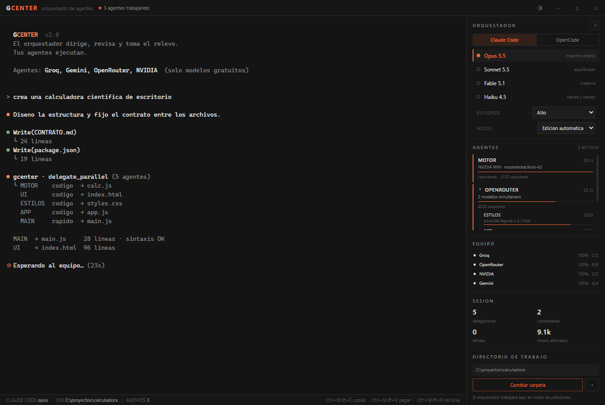
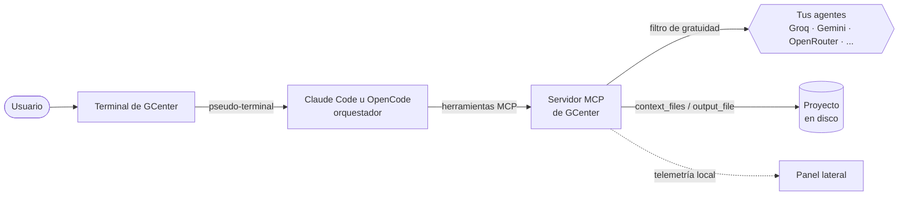

<div align="center">

# GCenter

**Tu orquestador dirige. Tus agentes ejecutan.**

Terminal de escritorio para Windows, Linux y macOS donde Claude Code u OpenCode
actúan como jefe de proyecto, reparten el trabajo entre los modelos de IA que tú
elijas y solo gastan los tokens caros en lo que de verdad requiere su criterio.

[](https://github.com/toroc07/gcenter/actions/workflows/ci.yml)
[](LICENSE)




<sub>Interfaz real de la aplicación, con datos de demostración.</sub>

</div>

---

## Índice

- [Qué es](#qué-es)
- [Características](#características)
- [Cómo funciona](#cómo-funciona)
- [Instalación](#instalación)
- [Primeros pasos](#primeros-pasos)
- [Agentes](#agentes)
- [Filtro de gratuidad](#filtro-de-gratuidad)
- [Por qué delegar ahorra tokens](#por-qué-delegar-ahorra-tokens)
- [Supervisión y relevo](#supervisión-y-relevo)
- [Uso de la interfaz](#uso-de-la-interfaz)
- [Contribuir](#contribuir)
- [Solución de problemas](#solución-de-problemas)
- [Seguridad y privacidad](#seguridad-y-privacidad)
- [Licencia](#licencia)

## Qué es

GCenter envuelve una sesión real de un **orquestador**:
[Claude Code](https://claude.com/claude-code) u [OpenCode](https://opencode.ai).
Funciona en una terminal con un panel lateral, y le da al orquestador un equipo
de **agentes**: los modelos de IA que tú añadas con tus propias API keys. También
le da las herramientas para dirigirlos:

- **Jefe de proyecto.** El orquestador diseña la estructura, fija los contratos
  entre archivos y reparte las piezas en paralelo.
- **Último revisor.** Nada llega a tu proyecto sin pasar por su revisión.
- **Suplente.** Si los agentes de una especialidad se agotan, el orquestador
  continúa esa parte desde donde se quedó.

GCenter no trae cuentas ni llaves de nadie. El orquestador usa la sesión que
tú hayas iniciado en él, y los agentes usan las API keys que tú añadas.

## Características

- **Dos orquestadores a elegir.** Claude Code u OpenCode, con un clic en el panel
  lateral.
- **Tus agentes, sin lista fija.** Añade cualquier proveedor compatible con
  OpenAI con solo un nombre y una API key. Los habituales se reconocen solos.
- **Filtro de gratuidad activable.** Activado, solo se usan modelos gratuitos
  verificados en todos tus agentes, y también en OpenCode. Desactivado, se pueden
  usar modelos de pago.
- **Delegación con ahorro real.** Los agentes leen los archivos de contexto y
  escriben su resultado directamente a disco. El orquestador recibe un resumen,
  no el código, y deja de pagar cada archivo dos veces.
- **Reparto por especialidad.** El orquestador pide `codigo`, `razonamiento`,
  `contextoLargo`, `redaccion`, `rapido` o `revision`, y GCenter elige el mejor
  modelo vivo entre tus agentes.
- **Lotes paralelos diversificados.** Las tareas de un mismo lote se reparten
  entre agentes distintos para no compartir cuota ni fallar todas a la vez.
- **Control de calidad.** Detecta archivos que no compilan, bucles, eco del
  enunciado y negativas, y reintenta con otro modelo sin intervención del
  orquestador.
- **Aprende de las revisiones.** Las valoraciones del orquestador reordenan el
  reparto y apartan a los modelos que rinden mal, también entre sesiones.
- **Panel en vivo.** Agentes en curso, salud del equipo y tokens ahorrados.
- **Tema claro y oscuro**, con un diseño sobrio de un único color de acento.

## Cómo funciona



GCenter arranca el orquestador con un servidor MCP propio y un prompt de
orquestador ([`prompts/orchestrator.md`](prompts/orchestrator.md)) que le explica
su papel. Todo eso se le pasa solo en ese arranque: GCenter no modifica la
configuración de Claude Code ni la de OpenCode. El servidor MCP expone seis
herramientas:

| Herramienta | Para qué sirve |
|---|---|
| `agents_available` | Tus agentes y sus modelos utilizables, consultados en vivo |
| `delegate` | Encargar una tarea, por especialidad o a un modelo concreto |
| `delegate_parallel` | Hasta 8 tareas simultáneas, repartidas entre modelos distintos |
| `agents_health` | Parte de situación: quién falla, quién está agotado, qué queda sin cubrir |
| `agents_feedback` | Valorar un resultado para que el reparto aprenda |
| `agents_running` | Agentes en curso y acumulado de la sesión |

## Instalación

### Requisitos

- **Windows** 10 u 11 de 64 bits, **Linux** x64 (Ubuntu 22.04+, Debian 12+ o
  equivalente) o **macOS** en un Mac con Apple Silicon (M1 o posterior).
- Al menos un orquestador instalado, con tu sesión iniciada:
  - **Claude Code**: `npm install -g @anthropic-ai/claude-code`, o en Linux y
    macOS, `curl -fsSL https://claude.ai/install.sh | bash`.
  - **OpenCode**: `npm install -g @opencode/cli`. Consulta
    [opencode.ai](https://opencode.ai) para ver otras formas de instalarlo.
- Opcional pero recomendado: una API key de algún [proveedor](#agentes).

### Descargas

Todos los paquetes están en [Releases](https://github.com/toroc07/gcenter/releases):

| Paquete | Sistema | Instalación |
|---|---|---|
| `GCenter-setup-<versión>.exe` | Windows | Instalador. **El recomendado**: arranca en menos de un segundo |
| `GCenter-portable-<versión>.exe` | Windows | Sin instalar; se autoextrae y es más lento al abrir |
| `gcenter_<versión>_amd64.deb` | Ubuntu, Debian y derivadas | `sudo apt install ./gcenter_<versión>_amd64.deb` |
| `GCenter-<versión>-x86_64.AppImage` | Cualquier distribución, sin instalar | `chmod +x GCenter-*.AppImage && ./GCenter-*.AppImage` |
| `GCenter-<versión>-arm64.dmg` | macOS (Apple Silicon) · **experimental** | Abre el `.dmg` y arrastra GCenter a Aplicaciones |

### macOS: la primera vez

La versión de macOS es **experimental**. Se compila y se prueba
automáticamente, pero todavía no se ha probado en un Mac real.

No está firmada por Apple, porque eso exige una cuenta de desarrollador de
pago. Por eso, la primera vez macOS la bloquea:

1. Intenta abrir GCenter. macOS dirá que no puede comprobar el desarrollador.
2. Ve a **Ajustes del Sistema → Privacidad y seguridad**, baja hasta el aviso
   sobre GCenter y pulsa **Abrir igualmente**.

Si macOS dice que la app "está dañada", quítale la marca de cuarentena desde
Terminal:

```bash
xattr -cr /Applications/GCenter.app
```

### Dónde busca GCenter el orquestador

En las rutas de instalación habituales y en el `PATH`:

- `~/.local/bin` y `~/.opencode/bin`
- la carpeta global de npm, incluidas las versiones de Node gestionadas con nvm
- Homebrew
- `/usr/local/bin`

Así lo encuentra aunque abras GCenter desde el menú de aplicaciones. Si solo
tienes instalado uno de los dos orquestadores, GCenter lo elige solo.

> En Ubuntu 24.04 y posteriores, la AppImage puede negarse a arrancar por las
> restricciones de sandbox del sistema. El `.deb` no tiene ese problema. Ver
> [Solución de problemas](#solución-de-problemas).

### Desde el código fuente

Si prefieres ejecutarlo o compilarlo tú mismo, consulta
[CONTRIBUTING.md](CONTRIBUTING.md).

## Primeros pasos

1. **En Windows, abre GCenter desde el Explorador**, no desde un terminal
   integrado (ver [Solución de problemas](#solución-de-problemas)).
2. Elige el orquestador en la parte de arriba del panel lateral: **Claude Code**
   u **OpenCode**.
3. Si no has iniciado sesión en él, te lo pedirá en el propio terminal de
   GCenter:
   - Claude Code: `/login`.
   - OpenCode: `/connect`, si no tienes ningún proveedor conectado.
4. Pulsa el engranaje y añade al menos un agente: un nombre y una API key.
   **Empieza por Groq**: es gratis, no pide tarjeta y responde casi al
   instante.
5. Elige el directorio de trabajo en el panel inferior derecho.
6. Pide algo al orquestador. Verás aparecer los agentes en el panel.

Sin agentes también funciona: el orquestador hace todo el trabajo él mismo.

## Agentes

Un agente es un proveedor de IA con tu API key. Para añadirlo, pulsa el
engranaje y escribe **un nombre y la llave**. GCenter prueba la conexión antes
de guardarlo y te dice cuántos modelos tiene y cuántos son gratuitos.

Puedes añadir varios agentes del mismo proveedor, por ejemplo dos cuentas de
Groq. Las llaves se guardan solo en tu equipo, en tu perfil de usuario y fuera
de cualquier proyecto.

### Proveedores que se reconocen solos

Por el nombre que escribas o por el formato de la llave:

| Proveedor | Cuota gratuita | Dónde destaca | Llave |
|---|---|---|---|
| [Groq](https://console.groq.com/keys) | Sin tarjeta · 30 req/min · 1.000 req/día | Velocidad (~300 tok/s): código y refactors | `gsk_…` |
| [Google Gemini](https://aistudio.google.com/apikey) | Sin tarjeta · ~10-15 req/min | Hasta 1M de tokens de contexto | `AIza…` |
| [OpenRouter](https://openrouter.ai/settings/keys) | ~20 modelos `:free` · 50 req/día sin saldo | Variedad de modelos abiertos | `sk-or-…` |
| [NVIDIA NIM](https://build.nvidia.com/) | Sin tarjeta · créditos gratuitos · ~40 req/min | Kimi K3, DeepSeek V4, Nemotron Ultra | `nvapi-…` |
| [Mistral](https://console.mistral.ai/api-keys) | Tier Experiment | Redacción, resumen y traducción | (por el nombre) |

### Cualquier otro proveedor

Si GCenter no reconoce el proveedor, te pedirá además su **URL base**. Vale
cualquier servicio compatible con la API de OpenAI, es decir, que tenga
`/models` y `/chat/completions`, por ejemplo `https://api.ejemplo.com/v1`.

Los catálogos se consultan **en vivo**: los identificadores de modelo rotan cada
pocas semanas y una lista fija acabaría enviando a los agentes contra modelos
que ya no existen.

## Filtro de gratuidad

Lo activas o desactivas en la ventana de agentes, y se aplica a **todos** tus
agentes. Viene activado.

Con el filtro **activado**, cada modelo se valida antes de cada llamada. Lo que
no pasa el filtro se rechaza sin llegar al proveedor, así que un intento
fallido no cuesta nada.

| Proveedor | Qué se considera gratis |
|---|---|
| Groq | Todo el catálogo: sin tarjeta no hay forma de facturar; pasarse de cuota devuelve `429` |
| Gemini | Solo Flash, Flash-Lite y Gemma; fuera Deep Research, los Pro recientes, vídeo, música e imagen |
| OpenRouter | Comprobación exacta contra el precio publicado: coste cero de entrada **y** de salida |
| NVIDIA NIM | Todo el catálogo: no admite tarjeta; al agotarse los créditos responde `402` |
| Mistral | Solo las familias Small, Ministral y Magistral Small |
| Otros proveedores | Solo si su catálogo publica precios y el modelo cuesta cero. **Si no publica precios, el agente queda bloqueado**, porque no hay forma de comprobar que no cobra |
| OpenCode (orquestador) | Solo Big Pickle y los modelos con sufijo `-free` |

Los catálogos mezclan modelos gratuitos y de pago. En una auditoría real,
OpenRouter ofrecía 442 modelos de los que solo 19 eran gratuitos.

Con el filtro **desactivado**, se usan todos los modelos de chat de tus agentes,
también los de pago, y OpenCode muestra todos los modelos que tengas
configurados. Desactívalo solo si quieres usar modelos de pago a propósito.

Con el filtro activado o desactivado, siempre se descartan los modelos que no
sirven para conversar: embeddings, voz, vídeo, imagen, OCR y moderación.

## Por qué delegar ahorra tokens

Lo caro del orquestador son sus **tokens de salida**: cada línea que teclea.
Delegar un archivo de forma ingenua no ahorra nada, porque el orquestador
teclea el contexto en el encargo, lee la respuesta del agente y después vuelve
a teclear el archivo para guardarlo. Paga el contenido dos veces.

GCenter cambia la cuenta con dos parámetros de `delegate`:

- **`context_files`**: el orquestador pasa rutas; GCenter lee los archivos y se
  los adjunta al agente.
- **`output_file`**: GCenter extrae el archivo de la respuesta, **comprueba que
  compila**, lo escribe a disco y devuelve al orquestador solo un resumen.

En una prueba real con tres archivos, el orquestador recibió un 72 % menos de
caracteres que si hubiera leído el código, y no tecleó ninguno. Un archivo que
no compila no se escribe: se reintenta con otro modelo.

Las escrituras quedan confinadas al directorio de trabajo y se guarda copia de
lo que se sobrescribe. En los modos que exigen supervisión, GCenter no escribe
por su cuenta:

- Claude Code: *Plan*, *Manual* y *No preguntar*.
- OpenCode: *Plan*.

## Supervisión y relevo

- **Salud del equipo.** Cada agente está *sano*, *degradado* (fallos seguidos o
  mala calidad) o *agotado* (cuota, créditos, red bloqueada). Los degradados y
  agotados dejan de recibir trabajo hasta recuperarse.
- **Reencaminado.** Si un agente falla por motivos ajenos a la tarea, la misma
  tarea pasa a otro agente sin que el orquestador intervenga.
- **Relevo al jefe.** Cuando ninguna opción cubre una especialidad, la
  delegación devuelve `RELEVO AL JEFE` y el orquestador asume esa parte. El
  relevo es granular: si se agotan los modelos de código, el orquestador
  programa y sigue delegando la documentación.
- **Avisos pasivos.** Cada delegación incluye un aviso cuando algún agente
  flaquea, sin que el orquestador tenga que preguntar.

## Uso de la interfaz

| Control | Función |
|---|---|
| **Orquestador** | Claude Code u OpenCode. Cambiar de orquestador empieza una conversación nueva |
| **Modelos** | Claude Code: Opus, Sonnet, Fable o Haiku, cambian en caliente con `/model`. OpenCode: los modelos que tengas en él, filtrados por el filtro de gratuidad |
| **Esfuerzo** | Solo Claude Code: nivel de razonamiento, cambia en caliente con `/effort` |
| **Modo** | Claude Code: Plan, Manual, No preguntar, Edición automática, Auto o Sin restricciones. OpenCode: Plan, Construir o Construir auto |
| **Equipo** | Salud de cada agente y su fiabilidad |
| **Directorio de trabajo** | Carpeta del proyecto; las últimas ocho quedan en el desplegable |
| ⚙ | Ventana de agentes y filtro de gratuidad |
| ◐ | Alterna entre modo claro y oscuro |

Los cambios que no se pueden aplicar en caliente reinician la sesión retomando
la conversación (`--continue`): el modo, y en OpenCode también el modelo. Cambiar
de carpeta inicia una sesión nueva.

| Atajo | Acción |
|---|---|
| `Ctrl+Shift+C` (`Cmd+C` en macOS) | Copiar la selección |
| `Ctrl+Shift+V` (`Cmd+V` en macOS) | Pegar |
| `Ctrl+Shift+R` | Reiniciar la sesión |

## Contribuir

Para ejecutar GCenter desde el código, compilar los paquetes, conocer la
estructura del proyecto o lanzar las pruebas, consulta
[CONTRIBUTING.md](CONTRIBUTING.md).

## Solución de problemas

<details>
<summary><b>La ventana no se abre o el proceso muere al instante</b></summary>

La variable de entorno `ELECTRON_RUN_AS_NODE` hace que Electron se ejecute como
Node y no cree la ventana. La definen algunos editores, como VS Code, en sus
terminales integrados. Abre GCenter desde el Explorador o desde una consola
limpia.

</details>

<details>
<summary><b>"No encuentro Claude Code" / "No encuentro OpenCode"</b></summary>

El orquestador no está instalado, o está en una ruta que GCenter no conoce.
Instálalo con las órdenes de [Requisitos](#requisitos) y comprueba que responde
desde un terminal (`claude --version` u `opencode --version`). Si tienes el
otro orquestador instalado, GCenter lo usa en su lugar.

</details>

<details>
<summary><b>OpenCode no muestra ningún modelo</b></summary>

Con el filtro de gratuidad activado solo se listan los gratuitos de OpenCode
(Big Pickle y los `-free`). Si tu cuenta u organización de OpenCode los tiene
desactivados, la lista sale vacía. Conecta un proveedor en OpenCode con
`/connect`, o desactiva el filtro para ver todos tus modelos.

</details>

<details>
<summary><b>Un agente aparece como "bloqueado"</b></summary>

Su proveedor no publica precios en su catálogo y el filtro de gratuidad está
activado, así que GCenter no puede comprobar que sus modelos sean gratis.
Desactiva el filtro si quieres usarlo de todas formas.

</details>

<details>
<summary><b>Groq falla con "red bloqueada"</b></summary>

Groq rechaza las conexiones desde IPs de VPN. Desactiva la VPN; los demás
proveedores sí funcionan con ella. En el panel **Equipo** lo verás marcado como
"tu red lo bloquea".

</details>

<details>
<summary><b>Un agente aparece como agotado</b></summary>

Has consumido su cuota gratuita, o el proveedor rechaza el acceso. No hay
ningún cargo: el proveedor simplemente deja de responder. GCenter reparte el
trabajo entre los demás y vuelve a intentarlo tras un tiempo de enfriamiento.
Conviene tener varios agentes configurados.

</details>

<details>
<summary><b>Un agente termina sin decir nada</b></summary>

Los modelos de razonamiento gastan tokens pensando antes de responder. Si el
presupuesto se agota razonando, la respuesta llega vacía. GCenter lo detecta y
reintenta con más margen; mientras piensan, el panel muestra "razonando...".

</details>

<details>
<summary><b>El portable tarda mucho en abrir</b></summary>

Un ejecutable portable se autoextrae y Windows lo verifica en cada arranque. Usa
el instalador, que no extrae nada. El primer arranque tras instalar también es
lento porque el antivirus analiza los binarios nuevos; solo ocurre una vez.

</details>

<details>
<summary><b>Linux: la AppImage no arranca ("SUID sandbox helper binary")</b></summary>

Ubuntu 24.04 y posteriores restringen los espacios de nombres de usuario que usa
el sandbox de Chromium, y la AppImage no puede configurar el suyo. Lo
recomendable es instalar el **`.deb`**, que sí lo configura al instalarse. Si
necesitas la AppImage, puedes lanzarla con `./GCenter-*.AppImage --no-sandbox`,
sabiendo que así la interfaz se ejecuta sin esa capa de aislamiento.

</details>

<details>
<summary><b>macOS: "GCenter está dañado" o "no se puede abrir"</b></summary>

Es el bloqueo de Gatekeeper a las apps sin firmar. Sigue los pasos de
[macOS: la primera vez](#macos-la-primera-vez).

</details>

## Seguridad y privacidad

- **Credenciales.** GCenter nunca ve las credenciales de Claude Code ni de
  OpenCode: las gestiona cada orquestador.
- **API keys.** Las de tus agentes se guardan en tu perfil de usuario, nunca en
  el proyecto, y no salen de tu equipo salvo hacia el proveedor al que
  pertenecen.
- **Uso de tus datos.** Varios proveedores **pueden usar los prompts del tier
  gratuito para entrenar sus modelos**: no delegues código ni datos que no
  quieras compartir.

Más detalles, y cómo informar de una vulnerabilidad, en
[SECURITY.md](SECURITY.md).

## Licencia

Distribuido bajo la licencia MIT. Ver [LICENSE](LICENSE).

GCenter es un proyecto independiente, no afiliado ni respaldado por Anthropic ni
por OpenCode. Claude y Claude Code son marcas de Anthropic. OpenCode y los
nombres de los demás proveedores pertenecen a sus respectivos titulares.
